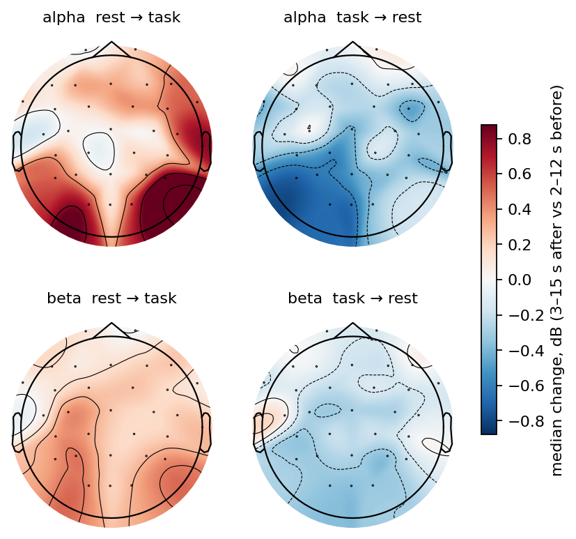
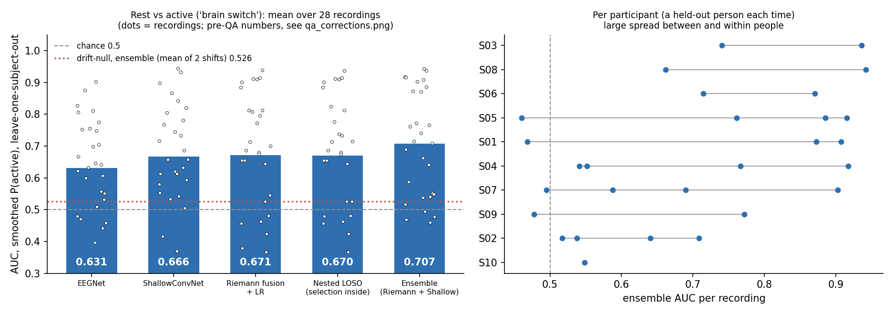
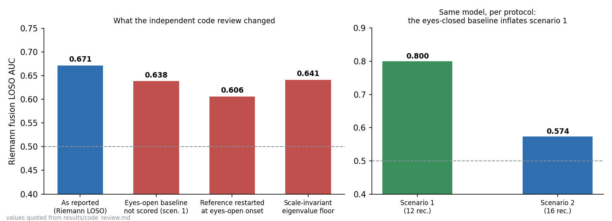
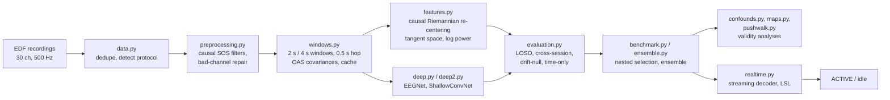

<p align="center">
  
</p>

<p align="center">
  <a href="https://git.io/typing-svg"></a>
</p>

<p align="center">
  
  
  
  
  
  
  
  
</p>

<p align="center">
  
  &nbsp;
  
  <br/><sub>Left: posterior alpha/beta power rises at rest to task and falls back at task to rest (median change in dB). Right: leave-one-subject-out AUC of the rest-vs-command decoder, pre-QA numbers, with the drift-null.</sub>
</p>

> **Master's Final Studies Project (PFE).** Decoding Idle / Push / Walk motor intent from a 30-channel EEG headset.
> The headline is as much about *evaluation rigour* as about accuracy: the early random-split scores (up to 98 %)
> were leakage, push vs walk turned out to be indistinguishable from elapsed time, and the rest-vs-command switch that
> does work (AUC about 0.67-0.71 before review corrections) is partly entangled with eye behaviour. All of it is
> documented, with the controls that revealed it.

## Table of contents

[Overview](#-overview) · [Results](#-results-at-a-glance) · [Features](#-features) · [Pipeline](#-pipeline) · [Requirements](#-requirements) · [Installation](#-installation--configuration) · [Data](#-data-layout) · [Reproduce](#-reproduce-the-experiments) · [Real-time demo](#-real-time-demo-lsl) · [Tests](#-tests) · [Limitations & roadmap](#-known-limitations--roadmap) · [Structure](#-project-structure) · [Author](#-author)

## 🧠 Overview

**Problem.** A brain-computer interface for motor intent should recognise whether a person is idle, imagining a *push*
or imagining a *walk*, and it should work for a person it has never seen, in real time, from a consumer-grade
30-channel headset. EEG is non-stationary and cue protocols are strongly time-structured, so naive evaluations
(random window splits, per-test-set tuning) report impressive but meaningless scores.

**Approach.** The project went through two phases.

1. **June 2025, baselines** (`experiments/baselines_2025/`): KNN, SVM (MRFO-tuned), logistic regression, random forest
   (Optuna), a fuzzy classifier and EEGNet on hand-crafted window features. Three-class accuracy 35-50 % (chance 33 %).
   A later audit ([`docs/legacy_audit.html`](docs/legacy_audit.html)) showed the models sat at about chance once train
   and test windows come from different blocks (median balanced accuracy 98 % random split vs 36 % block split).
2. **October 2026, the `eegbci` package** (`src/eegbci/`): a leakage-free rebuild with causal filtering and
   Riemannian re-centering, leave-one-subject-out evaluation, **drift-matched nulls**, a **time-only control**, nested
   model selection, confound analyses (blinks, EMG), and a streaming decoder that was checked against the offline code.

## 📊 Results at a glance

10 participants, 28 recordings, 30 channels at 500 Hz, two cue protocols. AUC chance level 0.5; 3-class balanced
accuracy chance 0.333. Leave-one-subject-out (LOSO) unless stated. Full tables in [`docs/evaluation.md`](docs/evaluation.md).

| Question | Result | Control / context |
|---|---|---|
| Idle vs Push vs Walk, within recording | balanced acc. **0.385** | drift-null 0.324 +/- 0.007, chance 0.333 |
| Push vs Walk, LOSO | EEG AUC **0.514** (raw features 0.573) | **time-only model 0.811**; crossed-order test min p_FWER 0.603. *Not decodable* |
| Rest vs command ("brain switch"), new person | Riemann fusion **0.671**, ShallowConvNet 0.666, EEGNet 0.631 | drift-null 0.489 +/- 0.040 |
| ... nested selection (selection inside the loop) | **0.670**, 9/10 participants above 0.5 | unbiased for the whole procedure |
| ... ensemble (Riemann + ShallowConvNet, 50/50 fixed a priori) | **0.707**, 10/10 participants above 0.5 | nulls 0.514 and 0.538 |
| ... after the independent code review | about **0.60-0.64** (Riemann) | scenario 1: 0.800 vs scenario 2: 0.574; see below |
| Real-time replay, held-out participant | 17-19 ms per decision, all onsets detected | AUC 0.888 / 0.828 / 0.695 / 0.411 over four recordings |

**What the controls revealed (kept in the results on purpose):**

- *Leakage.* Random window splits turn a 36 % model into a 98 % one ([audit](docs/legacy_audit.html)).
- *Time confound.* In both protocols push precedes walk, so a timestamp-only classifier beats every EEG model on
  push vs walk (0.677 vs 0.593 within recording, 0.811 vs 0.514 LOSO).
- *Protocol confound (found by code review).* The 120 s eyes-closed baseline of scenario 1 biases the causal reference;
  the eyes-open baseline then looks "rest-like", and a drift-null cannot reproduce it. Scenario 1 scores 0.800, scenario 2 0.574;
  excluding the eyes-open baseline gives 0.638, a scale-invariant eigenvalue floor 0.641, a restarted reference 0.606.
  The reported 0.67-0.71 are therefore upper bounds.
- *Neural but entangled.* The posterior beta increase at rest to task is neural (+0.33 dB, 26/28 recordings, p < 1e-4,
  89 % survives regression of eye/muscle proxies), yet a model on eye proxies alone reaches 0.640 and the EEG with the proxies
  removed 0.593. The switch reads a visual-disengagement / internal-attention state, not a pure motor command.
- *Warm-up gain.* A 3-5 min per-user warm-up lifts 0.662 to 0.709, but part of the gain also appears under the null.

<p align="center">
  
</p>

## ✨ Features

- **Causal by construction**: SOS filters with carried state, exponentially weighted Riemannian re-centering, causal EMA
  and adaptive threshold, so offline numbers correspond to online behaviour.
- **Leakage-free evaluation**: leave-one-cycle-out, cross-session and LOSO splits (a block is never split), nested
  selection, drift-matched nulls that retrain the whole pipeline, mandatory time-only control.
- **Models**: filter-bank covariance + tangent-space / log-power logistic regression, EEGNet, ShallowConvNet,
  bagged nets with inner-subject early stopping, equal-weight ensemble.
- **Validity analyses**: blink detection and EMG/EOG proxies from the EEG montage, decoding ablations, onset-locked
  multitaper maps with cluster permutation tests, push-vs-walk crossed-order test.
- **Real-time brain switch** over LSL with a simulator that replays a recording as a live stream.
- **Tested**: 78 unit tests on synthetic signals, including offline/online parity and known-bug regression tests.
- **Reproducible and private**: every path is set by an environment variable; no recording is committed and
  participants are pseudonymised (`S01`-`S10`).

## 🔬 Pipeline



## 🧰 Requirements

| Item | Requirement |
|---|---|
| OS | Windows, Linux or macOS (developed and tested on Windows 11) |
| Python | 3.10 or newer (tested with 3.12) |
| Libraries | NumPy, SciPy, pandas, scikit-learn >= 1.3, **MNE >= 1.5**, **pyRiemann >= 0.5**, joblib, matplotlib, **PyTorch >= 2.0**; **pylsl >= 1.16** for the real-time demo (installed versions tested: MNE 1.11, pyRiemann 0.8, PyTorch 2.5.1, pylsl 1.17.6) |
| Hardware | CPU is enough for the pipeline and for real-time decoding (about 17 ms per 0.5 s decision). A CUDA GPU is optional and speeds up the deep models (the bagged-net runs used one). A 30-channel, 500 Hz EEG headset that can publish an LSL stream is only needed for live use |
| Data | Your own EDF recordings following the protocol in [`data/README.md`](data/README.md); none are included |
| Disk | The window cache is large (several GB for 28 recordings); put it on a fast drive with `EEGBCI_CACHE_DIR` |
| Accounts / keys | None |

## ⚙️ Installation & configuration

```bash
git clone <this-repository>
cd eeg-pfe-new
python -m venv .venv && source .venv/bin/activate        # Windows: .venv\Scripts\activate
pip install -e ".[realtime,dev]"                          # or: pip install -r requirements.txt && pip install -e . --no-deps
# CPU-only PyTorch? see https://pytorch.org/get-started/locally/ and install torch first
```

Paths are read from environment variables (see [`.env.example`](.env.example)); nothing is machine-specific.

| Variable | Required | Description | Example |
|---|---|---|---|
| `EEGBCI_DATA_DIR` | yes, for anything that reads recordings | folder with the `*.edf` files | `/data/pfe/edf` |
| `EEGBCI_CACHE_DIR` | no | window / feature cache (default `.cache/eegbci`) | `/fast/cache` |
| `EEGBCI_RESULTS_DIR` | no | where logs, json and figures are written (default `results/`) | `./results` |
| `EEGBCI_MODELS_DIR` | no | trained real-time model (default `models/`) | `./models` |
| `EEGBCI_LEGACY_DATA_DIR` | only for `experiments/baselines_2025` | concatenated `.npz` sets of the 2025 notebooks | `/data/pfe/legacy` |

## 🗂️ Data layout

No data is committed (EEG from volunteers). Expected input: flat folder of EDF files named
`<session>_<subject>.edf`, e.g. `3_S05.edf`, `S07.edf`, 30 channels in the order of `eegbci.config.CHANNELS`, 500 Hz,
protocol markers stored as EDF annotations. The two cue protocols, the naming scheme and `scripts/rename_edf.py`
(to pseudonymise your own files from a private mapping) are described in [`data/README.md`](data/README.md).

## 🔁 Reproduce the experiments

All steps run from the repository root with `python -m eegbci.<step>` and log to `results/`.

<details open>
<summary><b>Main pipeline (2026)</b></summary>

```bash
export EEGBCI_DATA_DIR=/path/to/edf          # PowerShell: $env:EEGBCI_DATA_DIR = "C:\path\to\edf"

python -m eegbci.build_cache none 2.0        # windows, covariances, raw epochs (2 s)
python -m eegbci.build_cache none 4.0        # same for 4 s windows
python -m eegbci.neuro                       # transition-locked band power (what really changes)
python -m eegbci.explore round1              # feature / alignment / model screening (round1..round4)
python -m eegbci.explore confirm             # best configs against the drift-matched null
python -m eegbci.benchmark nested            # nested LOSO: the number to quote
python -m eegbci.deep eegnet                 # EEGNet LOSO   (also: shallow)
python -m eegbci.ensemble                    # Riemann + ShallowConvNet ensemble (+ null: python -m eegbci.ensemble 1)
python -m eegbci.explore calibration         # per-user warm-up simulation
python -m eegbci.classical2 all              # 13 classical candidates, nested selection
python -m eegbci.deep2 feats && python -m eegbci.deep2 net bag5_w2 --win 2 --K 5   # bagged nets (GPU recommended)
```
</details>

<details>
<summary><b>Validity and push-vs-walk analyses</b></summary>

```bash
python -m eegbci.confounds blinks            # then: physio, spectra, coupling
python -m eegbci.confounds_decode run base   # decoding ablations; then: summary
python -m eegbci.maps all                    # onset-locked maps, cluster statistics, figures
python -m eegbci.pushwalk frames             # then: onsets, crossed, decode, summary
python -m eegbci.decision run                # causal on/off decision rules
python -m eegbci.figures && python -m eegbci.report     # scalp maps and the HTML results page
python scripts/plot_summary.py               # figures of this README, from results/*.json
```
</details>

<details>
<summary><b>2025 baselines and the audit</b></summary>

```bash
pip install -e ".[legacy]"
# notebooks / scripts in experiments/baselines_2025/{knn,svm,logistic_regression,random_forest,fuzzy,eegnet}
# data builders in experiments/baselines_2025/extraction/ ; set EEGBCI_LEGACY_DATA_DIR
python scripts/audit/analyze.py audit_results.json                       # signal-level audit (needs EEGBCI_DATA_DIR)
python scripts/audit/build_report.py scripts/audit/audit_results.json docs/legacy_audit.html scripts/audit/template.html
```
</details>

## 📡 Real-time demo (LSL)

```bash
python -m eegbci.realtime train                  # fit the brain switch and save models/brain_switch.joblib
python -m eegbci.realtime replay S05             # hold S05 out and stream it through the online decoder

python -m eegbci.simulate_lsl S05-3 0            # terminal A: publish a recording as LSL stream "NeuroVisor-sim"
python -m eegbci.realtime lsl NeuroVisor-sim uV  # terminal B: live decisions, "uV" if the stream is in microvolts
```

Output per 0.5 s: `t=<seconds>  P(active)=<p>  ACTIVE` or `idle` (plus `[artifact]` when the window is flagged). Details, diagram and known gaps: [`docs/realtime.md`](docs/realtime.md).

## 🧪 Tests

```bash
pip install -e ".[dev]"
pytest            # 78 passed, 4 skipped on the reference machine (about 70 s)
```

The suite uses synthetic signals (no data needed); 4 tests that read real recordings or the cache are skipped when
`EEGBCI_DATA_DIR` has no data. It covers causality, window labelling, drift-null shifts, the streaming decoder against
the offline features, and regression tests for known issues.

## ⚠️ Known limitations & roadmap

**Limitations**

- 10 participants and 28 recordings: subject-level statistics are fragile.
- The reported 0.67-0.71 rest-vs-command AUCs predate the review corrections and are upper bounds (about 0.60-0.64 after
  the quantified corrections); the corrected pipeline has not been re-run end to end.
- The decoder partly reads eye behaviour; there is no EOG/EMG channel, so artefact control uses proxies from the EEG.
- Idle / Push / Walk is only marginally above chance, and push vs walk is indistinguishable from elapsed time.
- Online parity with offline (1e-14) holds for the Riemann branch only, and only for recordings without bad channels.

**Roadmap**

- [x] Causal pipeline, LOSO + drift-null + time-only control, nested selection
- [x] Independent code review, confound analyses, real-time decoder with LSL simulator
- [ ] Apply the review's fixes (reset reference at the eyes-open onset, scale-invariant eigenvalue floor, causal bad-channel handling online) and re-run LOSO and nulls
- [ ] New protocol: randomised block order, no eyes-closed baseline, recorded EOG
- [ ] Per-user warm-up with proper nulls for the calibration gain
- [ ] Complete the drift-null runs of the bagged deep branch
- [ ] Public-dataset configuration (PhysioNet EEGBCI / BCI IV 2a) to let others run the pipeline

<details>
<summary><b>Troubleshooting / FAQ</b></summary>

- *`no EDF files` or an empty recording list*: set `EEGBCI_DATA_DIR` and check the file names (`data/README.md`); the
  loader asserts the 30-channel order.
- *Out of memory while building the cache*: lower `n_jobs` in `build_cache.py` or build 2 s and 4 s windows separately.
- *`no LSL EEG stream found`*: start `simulate_lsl` first (or your headset's LSL outlet) and pass its stream name.
- *Decoder outputs look flat*: pass `uV` if the stream is in microvolts (the model works in volts).
</details>

## 📁 Project structure

<details>
<summary>Show tree</summary>

```text
.
├── src/eegbci/                 # the package (pip install -e .)
│   ├── config.py               # paths (env vars), protocols, bands
│   ├── data.py  preprocessing.py  windows.py  features.py
│   ├── evaluation.py  explore.py  benchmark.py  classical2.py  decision.py
│   ├── deep.py  deep2.py  ensemble.py
│   ├── confounds.py  confounds_decode.py  brainonly.py  maps.py  pushwalk.py  neuro.py
│   ├── realtime.py  simulate_lsl.py
│   ├── figures.py  report.py  assets/
├── tests/                      # pytest suite (synthetic data)
├── experiments/baselines_2025/ # first-phase notebooks: knn, svm, logistic_regression, random_forest, fuzzy, eegnet, extraction
├── scripts/                    # audit/ (legacy audit), plot_summary.py, rename_edf.py
├── results/                    # archived run outputs (txt, json, logs, figures); results/README.md
├── docs/                       # methodology.md, evaluation.md, realtime.md, legacy_audit.html, figures/
├── data/README.md              # expected data layout (no data committed)
├── pyproject.toml  requirements.txt  .env.example  LICENSE
```
</details>

## 🤝 Contributing

Issues and pull requests are welcome, especially a public-dataset configuration or fixes from the roadmap. Please run
`pytest` before opening a PR.

## 📄 License

MIT, see [LICENSE](LICENSE). The recordings are not part of the licence and are not distributed.

## 👤 Author

<table>
  <tr>
    <td><b>Hannoun Amine Amar</b><br/>AI Engineer / Fullstack Developer, Algeria<br/>
    <a href="https://github.com/ORD1STAR">GitHub @ORD1STAR</a> ·
    <a href="https://www.linkedin.com/in/hannoun-amine/">LinkedIn</a> ·
    <a href="mailto:hannoun.amine25@gmail.com">hannoun.amine25@gmail.com</a></td>
  </tr>
</table>

<p align="center">
  
</p>
