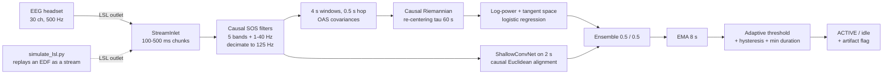

# Real-time pipeline (LSL)

`eegbci.realtime` turns the offline pipeline into a streaming "brain switch" (idle vs active command). It reads a
Lab Streaming Layer (LSL) EEG stream (30 channels, 500 Hz; microvolts or volts), and prints one decision per 0.5 s.



## Design

* **Same code path offline and online.** `BrainSwitchDecoder.push(chunk)` keeps filter states, decimation phase,
  covariance re-centering reference and EMA between calls, so chunk size does not change the result.
* **Unsupervised thresholding.** A window is "active" when the smoothed probability exceeds its own causal running mean
  (tau 120 s) by a margin. This removes per-person offsets without labels.
* **Artefact flag.** A window whose peak-to-peak (non-frontopolar channels) exceeds 150 uV is flagged.
* **Frozen bad channels.** Bad channels found during calibration are interpolated with a fixed matrix.

## Commands

```bash
# 1. train on all recordings and save models/brain_switch.joblib (needs the EDF data)
python -m eegbci.realtime train

# 2. offline check: hold one participant out, stream their recordings through the online decoder
python -m eegbci.realtime replay S05

# 3. live or simulated stream
python -m eegbci.simulate_lsl S05-3 0          # terminal A: replay a recording as LSL stream "NeuroVisor-sim"
python -m eegbci.realtime lsl NeuroVisor-sim uV # terminal B: decode it (use "uV" if the stream is in microvolts)
```

With a real headset, publish an LSL stream of type `EEG` with the 30 channels in the order of
`eegbci.config.CHANNELS`; `python -m eegbci.realtime lsl` (no name) resolves the first EEG stream.

## Measured behaviour

Held-out participant S05, 100 ms chunks, CPU (`results/replay_S05.txt`): 16.8-18.6 ms per 0.5 s decision with the
ensemble, all task onsets detected, 0 to 1.5 false activations per minute of rest, but AUC from 0.888 down to 0.411
across the four recordings. Known gaps documented by the QA review (`results/code_review.md`): offline/online parity
(1e-14) only holds for the Riemann branch and for recordings without bad channels; the decoder fails on chunks of
1200 samples or more; the replay resets the re-centering reference at 120 s for scenario-1 recordings (`reset_at_s`), whereas the live `lsl` mode starts with a fresh reference and no bad-channel list.
